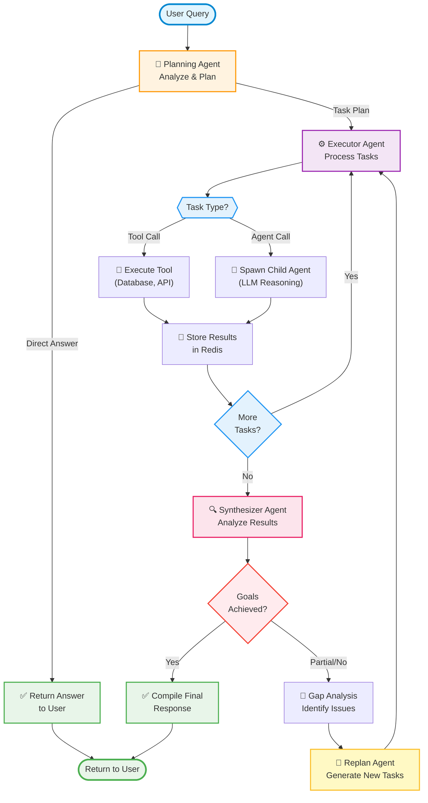

# Plan → Execute → Synthesize → Replan Architecture Design

**Status**: Draft Discussion  
**Date**: January 28, 2026  
**Purpose**: Design document for implementing an iterative agent workflow to replace the current one-shot execution pattern - proposed.

---

## Table of Contents

1. [Overview](#overview)
2. [Design Goals](#design-goals)
3. [JSON Schema Specifications](#json-schema-specifications)
4. [Current Architecture Analysis](#current-architecture-analysis)
5. [Proposed Architecture](#proposed-architecture)
6. [Component Details](#component-details)
7. [Workflow Execution Modes](#workflow-execution-modes)
8. [Task Type Classification](#task-type-classification)
9. [Implementation Plan](#implementation-plan)
10. [Open Questions & Considerations](#open-questions--considerations)
11. [References](#references)

---

## Overview

This document outlines the design for transforming the Content Creator Planner agent system from a single-pass execution model to an iterative, self-correcting workflow based on the **Plan → Execute → Synthesize → Replan** pattern.

### Core Principle

**A unified workflow handles all query types** - from simple Q&A to complex multi-step reasoning. The synthesizer determines goal fulfillment naturally, allowing simple queries to complete in one iteration while complex scenarios iterate as needed.

### High-Level Flow Diagram



**Key Components:**
- **Planning Agent**: Analyzes user queries and creates execution plans or provides direct answers
- **Executor Agent**: Processes tasks sequentially based on dependency graph, executing tools or spawning child agents
- **Synthesizer Agent**: Evaluates task results against goals and determines completion status
- **Replan Agent**: Generates corrective tasks when goals are not fully met
- **Iterative Loop**: System continues refining until user's goals are achieved

---

## Design Goals

### Primary Objectives

1. **Iterative Refinement**: Enable multi-cycle execution where agents can learn from previous results and adjust their approach
2. **Goal-Driven Completion**: Define clear success criteria and automatically determine when work is complete
3. **Self-Correction**: Detect gaps, failures, and incomplete work, then autonomously replan to address issues
4. **Unified Workflow**: Single execution pattern for all complexity levels (simple → complex)

### Non-Goals

- Multiple execution modes with complexity routing (over-engineering)
- Per-query mode classification and switching
- Manual user intervention for replanning decisions

---

## JSON Schema Specifications

This section defines the **canonical JSON formats** for all agent communications and data storage. These schemas are the single source of truth for implementation.

### 1. Planning Agent Response Format

The PlanningAgent MUST return JSON in this exact format:

```json
{
  "response_type": "direct_answer" | "task_plan",
  "direct_response": "string (required if response_type=direct_answer)",
  "tasks": [
    {
      "id": "string (unique within this plan, e.g., 'task_1', 'task_2')",
      "type": "tool_call" | "agent_call",
      "tool_name": "string (required if type=tool_call, e.g., 'manage_tasks')",
      "description": "string (human-readable task description)",
      "goal": "string (expected outcome, used by Synthesizer)",
      "depends_on": ["task_id_1", "task_id_2"],
      "context": {
        "// Tool-specific parameters (validated against ToolRegistry schemas)": "..."
      },
      "metadata": {
        "priority": "low" | "medium" | "high" | "urgent",
        "estimated_duration_seconds": "number (optional)",
        "retry_on_failure": "boolean (default: true)"
      }
    }
  ],
  "dependency_graph": {
    "task_1": [],
    "task_2": ["task_1"],
    "task_3": ["task_1", "task_2"]
  },
  "metadata": {
    "total_tasks": "number",
    "requires_llm_reasoning": "boolean (true if any agent_call tasks)",
    "estimated_total_duration": "number (seconds)"
  }
}
```

**Field Definitions**:

| Field | Type | Required | Description |
|-------|------|----------|-------------|
| `response_type` | enum | ✅ | Either `"direct_answer"` (simple Q&A) or `"task_plan"` (multi-step execution) |
| `direct_response` | string | Conditional | Required when `response_type="direct_answer"`. The complete answer to user's question. |
| `tasks` | array | Conditional | Required when `response_type="task_plan"`. Array of task objects. |
| `tasks[].id` | string | ✅ | Unique identifier within this plan (e.g., `"task_1"`, `"task_2"`). Used for dependency references. |
| `tasks[].type` | enum | ✅ | `"tool_call"` = direct tool execution (no LLM), `"agent_call"` = spawn child agent with LLM reasoning |
| `tasks[].tool_name` | string | Conditional | Required if `type="tool_call"`. Must match a tool in ToolRegistry (e.g., `"manage_tasks"`, `"manage_projects"`). |
| `tasks[].description` | string | ✅ | Human-readable task description for logging and debugging. |
| `tasks[].goal` | string | ✅ | Expected outcome. Synthesizer validates actual results against this goal. |
| `tasks[].depends_on` | array | ✅ | Array of task IDs that must complete before this task starts. Empty array `[]` means no dependencies. |
| `tasks[].context` | object | ✅ | Tool/agent-specific parameters. Structure validated by ToolRegistry schemas. |
| `tasks[].metadata` | object | Optional | Execution hints (priority, duration estimate, retry policy). |
| `dependency_graph` | object | ✅ | Adjacency list representation. Key = task ID, Value = array of task IDs it depends on. |
| `metadata` | object | Optional | Plan-level metadata for optimization and analytics. |

**Example - Direct Answer**:
```json
{
  "response_type": "direct_answer",
  "direct_response": "Based on your context, you should focus on video content for Q1 2026 because YouTube engagement is 3x higher than blog traffic."
}
```

**Example - Task Plan**:
```json
{
  "response_type": "task_plan",
  "tasks": [
    {
      "id": "task_1",
      "type": "tool_call",
      "tool_name": "manage_projects",
      "description": "Create Q1 2026 video project",
      "goal": "Project created in database with id returned",
      "depends_on": [],
      "context": {
        "action": "create",
        "projects": [
          {
            "name": "Q1 2026 Video Campaign",
            "description": "YouTube content series",
            "status": "PLANNING"
          }
        ]
      }
    },
    {
      "id": "task_2",
      "type": "tool_call",
      "tool_name": "manage_tasks",
      "description": "Create 3 video production tasks",
      "goal": "3 tasks created with TODO status",
      "depends_on": ["task_1"],
      "context": {
        "action": "create",
        "project_id": "${task_1.result.project_id}",
        "tasks": [
          {"title": "Script: AI productivity tips", "status": "TODO", "priority": "HIGH"},
          {"title": "Film: Tutorial recording", "status": "TODO", "priority": "MEDIUM"},
          {"title": "Edit: Final cut", "status": "TODO", "priority": "MEDIUM"}
        ]
      }
    },
    {
      "id": "task_3",
      "type": "agent_call",
      "description": "Analyze optimal posting schedule based on audience data",
      "goal": "Recommended posting times for each video",
      "depends_on": ["task_2"],
      "context": {
        "audience_timezone": "PST",
        "historical_engagement": "${user_context.analytics}",
        "video_count": 3
      }
    }
  ],
  "dependency_graph": {
    "task_1": [],
    "task_2": ["task_1"],
    "task_3": ["task_2"]
  },
  "metadata": {
    "total_tasks": 3,
    "requires_llm_reasoning": true,
    "estimated_total_duration": 45
  }
}
```

---

### 2. Task Storage Format (Redis)

Each task result is stored in Redis with these keys and structure:

**Redis Key Pattern**:
```
task:{conversation_id}:{message_id}:{task_id}:{user_id}
```

**Key Components**:
- `conversation_id`: UUID of the conversation (searchable)
- `message_id`: UUID of the user message that triggered this plan
- `task_id`: Task identifier from Planner's response (e.g., `task_1`)
- `user_id`: User ID for isolation

**Value Structure (JSON)**:
```json
{
  "task_id": "task_1",
  "conversation_id": "conv_abc123",
  "message_id": "msg_xyz789",
  "user_id": "user_456",
  "plan_iteration": 1,
  "task_definition": {
    "// Full task object from Planner response": "...",
    "id": "task_1",
    "type": "tool_call",
    "tool_name": "manage_tasks",
    "description": "Create 3 video tasks",
    "goal": "3 tasks created in database",
    "depends_on": [],
    "context": {}
  },
  "execution": {
    "status": "pending" | "in_progress" | "completed" | "failed" | "skipped",
    "started_at": "2026-01-28T10:00:00Z",
    "completed_at": "2026-01-28T10:00:15Z",
    "duration_seconds": 15,
    "executor_type": "tool" | "agent",
    "retry_count": 0,
    "max_retries": 3
  },
  "result": {
    "success": true,
    "output": {
      "// Tool/agent-specific output": "...",
      "created_task_ids": ["db_task_1", "db_task_2", "db_task_3"],
      "affected_rows": 3
    },
    "error": null
  },
  "dependencies": {
    "depends_on": [],
    "blocks": ["task_2"],
    "dependency_status": "resolved"
  },
  "metadata": {
    "llm_model_used": "gpt-4o (if agent_call)",
    "tokens_consumed": 1200,
    "tool_calls_made": 1,
    "cache_hit": false
  },
  "created_at": "2026-01-28T10:00:00Z",
  "updated_at": "2026-01-28T10:00:15Z",
  "ttl_expires_at": "2026-01-28T12:00:00Z"
}
```

**Redis Storage Patterns**:

1. **Store Task Result**:
```python
key = f"task:{conversation_id}:{message_id}:{task_id}:{user_id}"
value = json.dumps(task_result_object)
redis.setex(key, ttl=7200, value=value)  # 2 hour TTL
```

2. **Search by Conversation ID**:
```python
pattern = f"task:{conversation_id}:*"
task_keys = redis.keys(pattern)
tasks = [json.loads(redis.get(key)) for key in task_keys]
```

3. **Search by Message ID**:
```python
pattern = f"task:*:{message_id}:*"
task_keys = redis.keys(pattern)
```

4. **Get All Tasks for Plan**:
```python
pattern = f"task:{conversation_id}:{message_id}:*:{user_id}"
task_keys = redis.keys(pattern)
```

---

### 3. Dependency Graph Structure

The dependency graph uses **adjacency list** format for efficient traversal:

```json
{
  "task_1": [],
  "task_2": ["task_1"],
  "task_3": ["task_1"],
  "task_4": ["task_2", "task_3"],
  "task_5": ["task_4"]
}
```

**Format Rules**:
- **Key**: Task ID (string)
- **Value**: Array of task IDs that this task depends on (prerequisites)
- **Empty array `[]`**: Task has no dependencies (can run immediately)

**Execution Order** (Topological Sort):
1. Execute all tasks with `depends_on: []` in parallel
2. After task completes, mark as done and check which blocked tasks can now run
3. Repeat until all tasks complete or a failure occurs

**Example Execution Flow**:
```
Iteration 1 (parallel): task_1
Iteration 2 (parallel): task_2, task_3  (wait for task_1)
Iteration 3 (sequential): task_4        (wait for task_2 AND task_3)
Iteration 4 (sequential): task_5        (wait for task_4)
```

**Validation Rules**:
1. No circular dependencies (detect cycles during validation)
2. All referenced task IDs must exist in `tasks[]` array
3. Graph must be connected (no orphaned tasks unless intentional)

---

### 4. Plan Storage Format (Redis)

**Redis Key Pattern**:
```
plan:{conversation_id}:{iteration}:{user_id}
```

**Value Structure (JSON)**:
```json
{
  "plan_id": "plan_abc123",
  "conversation_id": "conv_abc123",
  "message_id": "msg_xyz789",
  "user_id": "user_456",
  "iteration": 1,
  "planner_response": {
    "// Full Planner response (see section 1)": "...",
    "response_type": "task_plan",
    "tasks": [],
    "dependency_graph": {}
  },
  "execution_summary": {
    "total_tasks": 5,
    "tasks_completed": 3,
    "tasks_failed": 1,
    "tasks_pending": 1,
    "started_at": "2026-01-28T10:00:00Z",
    "updated_at": "2026-01-28T10:05:00Z",
    "estimated_completion": "2026-01-28T10:10:00Z"
  },
  "metadata": {
    "user_message": "Create video tasks for Q1",
    "created_at": "2026-01-28T10:00:00Z",
    "ttl_expires_at": "2026-01-28T12:00:00Z"
  }
}
```

---

### 5. Synthesis Report Format (Redis)

**Redis Key Pattern**:
```
synthesis:{conversation_id}:{iteration}:{user_id}
```

**Value Structure (JSON)**:
```json
{
  "synthesis_id": "synth_abc123",
  "conversation_id": "conv_abc123",
  "message_id": "msg_xyz789",
  "user_id": "user_456",
  "iteration": 1,
  "goal_achieved": true,
  "summary": "Successfully created 5 tasks across 2 projects. All tasks assigned to Q1 2026 timeline with priorities set.",
  "gaps": [],
  "recommendations": [],
  "final_response": "I've created 5 video production tasks for your Q1 2026 campaign...",
  "confidence": 0.95,
  "analysis": {
    "original_goal": "Create video tasks for Q1",
    "tasks_analyzed": 5,
    "success_criteria_met": [
      "All tasks created in database",
      "Tasks linked to Q1 project",
      "Priorities assigned based on workflow"
    ],
    "success_criteria_missed": []
  },
  "task_results": [
    {
      "task_id": "task_1",
      "status": "completed",
      "goal": "Project created in database",
      "goal_met": true,
      "result_summary": "Project created with ID proj_123"
    },
    {
      "task_id": "task_2",
      "status": "completed",
      "goal": "3 tasks created with TODO status",
      "goal_met": true,
      "result_summary": "Created 3 tasks (IDs: task_1, task_2, task_3)"
    }
  ],
  "metadata": {
    "tasks_completed": 5,
    "tasks_failed": 0,
    "agent_calls_used": 1,
    "total_duration_seconds": 42,
    "synthesized_at": "2026-01-28T10:05:00Z",
    "ttl_expires_at": "2026-01-28T12:00:00Z"
  }
}
```

**When `goal_achieved: false`**:
```json
{
  "goal_achieved": false,
  "summary": "Partially completed. Created project but task creation failed due to missing project_id.",
  "gaps": [
    "task_2 failed with error: project_id is required",
    "task_3 skipped because it depends on task_2"
  ],
  "recommendations": [
    "Replan task_2 to use actual project_id from task_1 result",
    "Verify dependency resolution logic"
  ],
  "final_response": null,
  "confidence": 0.3,
  "task_results": [
    {
      "task_id": "task_1",
      "status": "completed",
      "goal_met": true
    },
    {
      "task_id": "task_2",
      "status": "failed",
      "goal_met": false,
      "failure_reason": "Missing required parameter: project_id"
    },
    {
      "task_id": "task_3",
      "status": "skipped",
      "goal_met": false,
      "skip_reason": "Dependency task_2 failed"
    }
  ]
}
```

---

### 6. Searchability & Indexing

**Search Patterns by Message ID**:
```bash
# Get all tasks for a specific message
redis-cli KEYS "task:*:{message_id}:*"

# Get plan for message
redis-cli GET "plan:{conversation_id}:{iteration}:{user_id}"

# Get synthesis for message
redis-cli GET "synthesis:{conversation_id}:{iteration}:{user_id}"
```

**Search Patterns by Conversation ID**:
```bash
# All tasks in conversation
redis-cli KEYS "task:{conversation_id}:*"

# All plans in conversation (across iterations)
redis-cli KEYS "plan:{conversation_id}:*"

# All synthesis reports
redis-cli KEYS "synthesis:{conversation_id}:*"
```

**Search Patterns by User ID**:
```bash
# All user's tasks
redis-cli KEYS "task:*:*:*:{user_id}"

# All user's plans
redis-cli KEYS "plan:*:*:{user_id}"
```

**Task ID Uniqueness**:
- Task IDs are unique **within a plan** (scoped to `message_id`)
- Across plans, use composite key: `{conversation_id}:{message_id}:{task_id}`
- For global uniqueness, include `user_id`: `{conversation_id}:{message_id}:{task_id}:{user_id}`

---

### 7. Schema Validation Checklist

Before storing any data in Redis, validate:

✅ **Planning Agent Response**:
- `response_type` is either `"direct_answer"` or `"task_plan"`
- If `task_plan`, `tasks[]` array is not empty
- All task IDs in `dependency_graph` exist in `tasks[]`
- No circular dependencies in graph
- All `tool_call` tasks have `tool_name` matching ToolRegistry

✅ **Task Storage**:
- Redis key follows pattern: `task:{conversation_id}:{message_id}:{task_id}:{user_id}`
- `task_definition` matches Planner's task object exactly
- `execution.status` is valid enum value
- `result.output` is non-null if `status=completed`

✅ **Dependency Graph**:
- All keys in graph are valid task IDs
- All values are arrays (even if empty)
- Topological sort succeeds (no cycles)

✅ **Synthesis Report**:
- `task_results[]` covers all tasks from plan
- `goal_achieved` aligns with analysis (true if all goals met)
- `gaps[]` is empty if `goal_achieved=true`
- `recommendations[]` is empty if `goal_achieved=true`

---

## Current Architecture Analysis

### What Exists ✅

1. **PlanningAgent** (`python-agents/agents/planner.py`)
   - Main orchestrator with OpenAI function calling
   - Tools: `manage_user_tasks`, `manage_user_context`, `delegate_to_agents`
   - Comprehensive agent call logging to PostgreSQL
   - Context caching for returning users
   - Timeout handling (600s)

2. **ExecutorAgent** (`python-agents/agents/executor.py`)
   - Child agent for executing subtasks
   - Fetches context from Redis with namespaced keys
   - Updates subtask status: `pending` → `in_progress` → `completed`/`failed`
   - Stores execution outputs in Redis
   - Independent LLM calls for reasoning

3. **UserTaskManagerAgent** (`python-agents/agents/task_manager.py`)
   - Database CRUD operations for tasks and projects
   - Tools: `manage_tasks`, `manage_projects`
   - Direct PostgreSQL writes via utils/task_inserter.py and utils/task_updater.py

4. **ContextManagerAgent** (`python-agents/agents/context_manager.py`)
   - Manages user context in markdown files
   - Storage: `/app/agent_context/{userId}/`
   - Tools: `manage_context_files` (list/read/write/append)

5. **Redis Infrastructure** (`python-agents/storage/redis_client.py`)
   - Message storage, subtask coordination
   - Namespaced keys: `subtask:{parent_id}:{subtask_id}:{user_id}`
   - TTL-based expiration (default: 1 hour for subtasks)
   - Connection pooling (max 10 connections)

6. **Agent Call Logging** (`python-agents/storage/agent_call_log.py`)
   - PostgreSQL table: `AgentCallLog`
   - Tracks: tool calls, results, duration, status, metadata
   - Detailed tool execution logs with timing and success/failure

### What's Missing ❌

1. **SynthesizerAgent**: No component to analyze execution quality and determine goal fulfillment
2. **Iterative Orchestration**: Current `orchestrator.py` only has cost tracking utility
3. **Dependency Graph Resolution**: `delegate_to_agents` runs all subtasks in parallel (no sequential execution)
4. **Replanning Logic**: One-shot execution with no feedback loop
5. **Goal Tracking**: No explicit success criteria or completion detection

---

## Proposed Architecture

### Component Diagram

```
┌─────────────────────────────────────────────────────────────────┐
│                     WorkflowOrchestrator                        │
│  (State Machine: PLANNING → EXECUTING → SYNTHESIZING → ...)    │
└────────┬──────────────────────────┬─────────────────────────────┘
         │                          │
         ▼                          ▼
┌─────────────────┐        ┌─────────────────┐
│ PlanningAgent   │        │ SynthesizerAgent│
│                 │        │                 │
│ • Task creation │        │ • Result analysis│
│ • Dependency    │        │ • Gap detection │
│   graph output  │        │ • Goal check    │
│ • Tool/agent    │        │ • Replan decision│
│   classification│        │                 │
└────────┬────────┘        └────────▲────────┘
         │                          │
         │ (uses definitions from)  │
         │                          │
         ▼                          │
┌─────────────────────────────────────┐
│         ToolRegistry                │
│  (Single Source of Truth)           │
│                                     │
│ • Tool definitions                  │
│ • Parameter schemas                 │
│ • Use case guidelines               │
│ • Type classification (tool/agent)  │
│ • System prompt formatter           │
└─────────────────────────────────────┘
         │
         ▼
┌─────────────────────────────────────┐
│        TaskExecutor                 │
│  (Routes by task.type)              │
│                                     │
│  ┌──────────────┐  ┌──────────────┐│
│  │ ToolExecutor │  │ExecutorAgent ││
│  │ (Direct tool │  │ (LLM-based   ││
│  │  invocation) │  │  reasoning)  ││
│  └──────────────┘  └──────────────┘│
└─────────────────────────────────────┘
         │
         ▼
┌─────────────────────────────────────┐
│   Redis Storage (Temporary State)   │
│                                     │
│ • Task results                      │
│ • Workflow state                    │
│ • Execution status                  │
│ • Synthesis reports                 │
└─────────────────────────────────────┘
         │
         ▼
┌─────────────────────────────────────┐
│  PostgreSQL (Persistent Storage)    │
│                                     │
│ • AgentCallLog (audit trail)        │
│ • Tasks & Projects (user data)      │
│ • Conversations (chat history)      │
└─────────────────────────────────────┘
```

### Workflow State Machine

```
┌───────────┐
│  PLANNING │
└─────┬─────┘
      │ Planner creates tasks or direct response
      ▼
┌───────────┐         response_type: "direct_answer"
│ EXECUTING │────────────────────────────┐
└─────┬─────┘                            │
      │ Run tasks (tools + agents)       │
      ▼                                  │
┌──────────────┐                         │
│ SYNTHESIZING │◄────────────────────────┘
└─────┬────────┘
      │ Analyze results
      ▼
      ┌───────────────────┐
      │ goal_achieved?    │
      └───────┬───────────┘
              │
        ┌─────┴─────┐
        │           │
       YES          NO
        │           │
        ▼           ▼
   ┌──────────┐  ┌────────────┐
   │COMPLETED │  │ REPLANNING │
   └──────────┘  └─────┬──────┘
                       │ gaps → context
                       ▼
                  ┌───────────┐
                  │ PLANNING  │ (iteration++)
                  └───────────┘
```

---

## Component Details

### 0. ToolRegistry (New - Single Source of Truth)

**Role**: Central registry for all available tools with definitions, schemas, and usage guidelines

**Purpose**:
- Maintain tool definitions in one place
- Inject tool knowledge into PlanningAgent system prompt
- Provide schemas for ToolExecutor validation
- Enable easy addition of new tools without prompt surgery

**Structure**:
```python
# python-agents/agents/tools/registry.py

from typing import Dict, List, Literal
from pydantic import BaseModel

class ToolDefinition(BaseModel):
    name: str
    type: Literal["tool_call", "agent_call"]
    description: str
    parameters: Dict  # JSON schema for parameters
    use_cases: List[str]  # When to use this tool
    examples: List[Dict]  # Sample task structures

class ToolRegistry:
    """Central registry for all available tools"""
    
    @classmethod
    def get_all_tools(cls) -> List[ToolDefinition]:
        return [
            ToolDefinition(
                name="manage_tasks",
                type="tool_call",
                description="Create, update, search, or delete tasks in PostgreSQL database",
                parameters={
                    "action": {"type": "string", "enum": ["create", "update", "search", "delete", "get"]},
                    "project_id": {"type": "string", "optional": True},
                    "tasks": {"type": "array", "items": "object"},
                    "status": {"type": "string", "optional": True}
                },
                use_cases=[
                    "User wants to create new tasks",
                    "Update task status or details",
                    "Search for tasks by criteria",
                    "Find blocked/completed tasks"
                ],
                examples=[{
                    "id": "task_1",
                    "type": "tool_call",
                    "tool_name": "manage_tasks",
                    "description": "Create 3 video tasks",
                    "context": {
                        "action": "create",
                        "tasks": [{"title": "Script", "status": "TODO"}]
                    }
                }]
            ),
            ToolDefinition(
                name="manage_projects",
                type="tool_call",
                description="Create, update, or list projects",
                parameters={
                    "action": {"type": "string", "enum": ["create", "update", "list", "get"]},
                    "projects": {"type": "array", "items": "object"}
                },
                use_cases=["User organizes tasks into projects", "Create new project structure"],
                examples=[]
            ),
            ToolDefinition(
                name="manage_context_files",
                type="tool_call",
                description="Read/write user context markdown files for preferences, goals, notes",
                parameters={
                    "action": {"type": "string", "enum": ["list", "read", "write", "append"]},
                    "filename": {"type": "string"},
                    "content": {"type": "string", "optional": True}
                },
                use_cases=["Store user preferences", "Retrieve user goals", "Save meeting notes"],
                examples=[]
            ),
            ToolDefinition(
                name="redis_storage",
                type="tool_call",
                description="Store/retrieve temporary data in Redis (TTL-based)",
                parameters={
                    "operation": {"type": "string", "enum": ["set", "get", "delete"]},
                    "key": {"type": "string"},
                    "value": {"type": "any", "optional": True},
                    "ttl": {"type": "integer", "optional": True}
                },
                use_cases=["Cache intermediate results", "Store session state"],
                examples=[]
            ),
            ToolDefinition(
                name="executor_agent",
                type="agent_call",
                description="Spawn child agent with LLM reasoning for analysis, decisions, content generation",
                parameters={
                    "task_description": {"type": "string"},
                    "context": {"type": "object"},
                    "expected_output": {"type": "string"}
                },
                use_cases=[
                    "Analyze why metric dropped",
                    "Generate content outline",
                    "Decide task priority based on blockers",
                    "Recommend strategy based on data"
                ],
                examples=[{
                    "id": "task_2",
                    "type": "agent_call",
                    "description": "Analyze engagement drop on recent posts",
                    "context": {"posts": [...], "metrics": {...}}
                }]
            )
        ]
    
    @classmethod
    def format_for_prompt(cls) -> str:
        """Generate markdown documentation for PlanningAgent system prompt"""
        tools = cls.get_all_tools()
        output = "## Available Tools (Reference Only - Do NOT Execute)\n\n"
        output += "You create task plans that reference these tools. The TaskExecutor will execute them.\n\n"
        
        for i, tool in enumerate(tools, 1):
            output += f"### {i}. {tool.name}\n"
            output += f"- **Type**: `{tool.type}`\n"
            output += f"- **Description**: {tool.description}\n"
            output += f"- **Parameters**:\n"
            for param, schema in tool.parameters.items():
                optional = " (optional)" if schema.get("optional") else ""
                output += f"  - `{param}`: {schema.get('type')}{optional}\n"
            output += f"- **Use When**: {' | '.join(tool.use_cases)}\n"
            if tool.examples:
                output += f"- **Example**:\n```json\n{json.dumps(tool.examples[0], indent=2)}\n```\n"
            output += "\n"
        
        return output
    
    @classmethod
    def get_tool_schema(cls, tool_name: str) -> Dict:
        """Get JSON schema for ToolExecutor validation"""
        tools = cls.get_all_tools()
        for tool in tools:
            if tool.name == tool_name:
                return tool.parameters
        raise ValueError(f"Tool '{tool_name}' not found in registry")
```

**Usage in PlanningAgent**:
```python
from agents.tools.registry import ToolRegistry

class PlanningAgent:
    def __init__(self):
        # Inject tool definitions into system prompt at runtime
        self.system_prompt = f"""
        You are a planning agent that creates structured task plans.
        
        {ToolRegistry.format_for_prompt()}
        
        ## Output Format
        Return JSON with this structure:
        {{
          "response_type": "direct_answer" | "task_plan",
          "direct_response": "..." (if type=direct_answer),
          "tasks": [...] (if type=task_plan),
          "dependency_graph": {{...}}
        }}
        
        ## Task Type Selection Rules
        - Use `type: "tool_call"` for deterministic database/file operations
        - Use `type: "agent_call"` for analysis, reasoning, content generation
        - Always specify `tool_name` for tool_call tasks
        - Always include `context` with required parameters
        """
```

**Benefits**:
1. **Single Source of Truth**: Tool definitions maintained in one file
2. **Easy Updates**: Adding new tools = update registry, auto-reflected in prompt
3. **Validation**: ToolExecutor uses same schemas to validate task parameters
4. **Documentation**: Self-documenting with use cases and examples
5. **Type Safety**: Pydantic models ensure schema correctness

---

### 1. PlanningAgent (Enhanced)

**Role**: Pure task creator - does not respond directly to user (except for simple Q&A)

**Input**:
- User message (conversation history)
- Synthesis gaps (if replanning)
- **Tool definitions injected from ToolRegistry**
- User context from ContextManagerAgent

**Output**: Structured JSON
```json
{
  "response_type": "direct_answer" | "task_plan",
  "direct_response": "Answer text..." (if type=direct_answer),
  "tasks": [
    {
      "id": "task_1",
      "type": "tool_call" | "agent_call",
      "tool_name": "manage_tasks" (if type=tool_call),
      "description": "Create 3 YouTube video tasks",
      "goal": "Tasks created in database",
      "depends_on": ["task_0"],  // Dependency array
      "context": {
        "project_id": "123",
        "task_details": [...]
      }
    }
  ],
  "dependency_graph": {
    "task_1": [],
    "task_2": ["task_1"],
    "task_3": ["task_1", "task_2"]
  }
}
```

**Key Changes**:
- Add structured output schema with task types
- Include dependency graph for sequential execution
- Distinguish tool calls vs agent calls (LLM reasoning)
- Update prompt to guide task type selection

**Storage**:
- Plan stored in Redis: `plan:{conversation_id}:{iteration}:{user_id}` (TTL: 2 hours)

---

### 2. SynthesizerAgent (New)

**Role**: Analyze execution quality, detect gaps, decide goal fulfillment

**Input**:
- Original user query (goal)
- Planning Agent's output (tasks or direct response)
- Execution results from Redis (all task outputs)
- Conversation history

**Output**: Synthesis report (concrete JSON schema)
```json
{
  "synthesis_id": "synth_abc123",
  "timestamp": "2026-01-28T10:30:00Z",
  
  // CORE METRICS (required)
  "completion_score": 0.95,        // float 0-1: how completely the goal was met
  "confidence": 0.90,              // float 0-1: confidence in the assessment
  "goal_achieved": true,           // boolean: derived from thresholds below
  
  // DECISION SIGNAL (required)
  "action": "publish" | "replan" | "partial_publish",
  
  // GAP ANALYSIS (required, can be empty array)
  "gaps": [
    {
      "type": "task_failure" | "missing_step" | "incomplete_output" | "validation_error",
      "severity": "critical" | "major" | "minor",
      "description": "Task 3 failed - database connection timeout",
      "affected_task_id": "task_3",
      "recommendation": "Retry with exponential backoff or check database connectivity"
    }
  ],
  
  // USER-FACING RESPONSE (required if action=publish or partial_publish)
  "final_response": {
    "message": "I've successfully created 5 content tasks for your video project...",
    "format": "text" | "markdown" | "structured",
    "attachments": [  // optional: task IDs, file paths, etc.
      {"type": "task", "id": "task_1", "title": "Video Script"},
      {"type": "task", "id": "task_2", "title": "Video Recording"}
    ]
  },
  
  // ANALYSIS SUMMARY (required)
  "summary": {
    "user_query": "Create 5 tasks for video production workflow",
    "execution_summary": "Executed 1 tool_call task (manage_tasks) successfully",
    "outcome": "All 5 tasks created with proper dependencies and priorities"
  },
  
  // EXECUTION METADATA (required)
  "metadata": {
    "iteration_number": 1,
    "tasks_planned": 1,
    "tasks_completed": 1,
    "tasks_failed": 0,
    "tool_calls_used": 1,
    "agent_calls_used": 0,
    "total_execution_time_ms": 1250
  },
  
  // REPLAN CONTEXT (required if action=replan)
  "replan_context": {
    "reason": "Task validation failed, need to fetch project_id first",
    "priority_gaps": ["gap_id_1", "gap_id_2"],  // IDs from gaps array
    "suggested_approach": "Create task to fetch default project, then retry original operation"
  }
}
```

**Decision Logic** (Publish vs Replan):
```python
def determine_action(completion_score, confidence, gaps):
    # CRITICAL FAILURES → Always replan
    critical_gaps = [g for g in gaps if g['severity'] == 'critical']
    if critical_gaps:
        return 'replan'
    
    # HIGH QUALITY → Publish to user
    if completion_score >= 0.85 and confidence >= 0.7:
        return 'publish'
    
    # PARTIAL SUCCESS → Publish with caveats if acceptable threshold
    if completion_score >= 0.6 and confidence >= 0.6 and len(gaps) <= 2:
        return 'partial_publish'  # Include gaps in user response
    
    # LOW QUALITY → Replan
    return 'replan'
```

**Key Logic**:
- For `response_type: "direct_answer"`: Validate answer completeness against query
- For `response_type: "task_plan"`: Analyze execution results
  - Check: Did all tasks succeed?
  - Check: Do results satisfy original user goal?
  - Check: Are there logical gaps or missing steps?
- **Calculate completion_score** (0-1): Percentage of user goal satisfied
- **Calculate confidence** (0-1): Certainty in the assessment
- **Perform gap analysis**: Categorize by severity (critical/major/minor)
- **Determine action**: Apply decision thresholds to set `action` field
- **Populate replan_context**: If action=replan, provide context for next iteration

**Storage**:
- Synthesis report in Redis: `synthesis:{conversation_id}:{iteration}:{user_id}` (TTL: 2 hours)
- Metadata logged to `AgentCallLog` for audit

---

### 3. TaskExecutor (New) + ExecutorAgent (Enhanced)

**TaskExecutor Role**: Route tasks to appropriate execution mode

**Routing Logic**:
```python
async def execute_task(self, task: Dict) -> Dict:
    if task['type'] == 'tool_call':
        # Direct tool invocation (no LLM needed)
        return await ToolExecutor.execute(
            tool_name=task['tool_name'],
            params=task['context']
        )
    elif task['type'] == 'agent_call':
        # Spawn child ExecutorAgent with LLM reasoning
        executor = ExecutorAgent(...)
        return await executor.execute_subtask(
            task_id=task['id'],
            context=task['context']
        )
```

**ToolExecutor** (New Class):
- **Purpose**: Direct tool execution without LLM overhead
- **Tools Supported**: All existing tools (manage_tasks, redis_storage, manage_context, etc.)
- **Validation**: Schema validation before execution
- **Error Handling**: Fail fast with detailed error messages

**ExecutorAgent** (Enhanced):
- Keep existing LLM-based reasoning capability
- Used for tasks requiring decision-making, analysis, content generation
- Examples: "Analyze why engagement dropped", "Generate content outline", "Decide next action based on blocked tasks"

**Dependency Graph Execution**:
```python
async def execute_with_dependencies(self, tasks: List[Dict], dependency_graph: Dict):
    # Topological sort for execution order
    execution_order = topological_sort(dependency_graph)
    
    results = {}
    for task_id in execution_order:
        task = find_task_by_id(tasks, task_id)
        
        # Wait for dependencies
        dependencies = dependency_graph[task_id]
        await wait_for_tasks(dependencies, results)
        
        # Execute task (parallel for independent tasks)
        result = await self.execute_task(task)
        results[task_id] = result
        
        # Store in Redis
        await redis.set(f"task_result:{parent_id}:{task_id}:{user_id}", 
                       json.dumps(result), ex=7200)
    
    return results
```

---

### 4. WorkflowOrchestrator (New)

**Role**: Manage state machine, coordinate agents, track iterations

**State Management**:
```python
class WorkflowState:
    conversation_id: str
    user_id: str
    iteration: int  # Current iteration (1-based)
    max_iterations: int = 3
    current_phase: str  # PLANNING | EXECUTING | SYNTHESIZING | REPLANNING | COMPLETED
    plan: Dict = None
    execution_results: Dict = None
    synthesis_report: Dict = None
    goal_achieved: bool = False
    started_at: datetime
    updated_at: datetime
```

**Main Loop**:
```python
async def execute_workflow(self, user_message: str, conversation_id: str, user_id: str):
    state = await self.initialize_state(conversation_id, user_id)
    
    while state.iteration <= state.max_iterations and not state.goal_achieved:
        # 1. PLANNING
        await self.notify_websocket("Planning...")
        plan = await self.planner.create_plan(
            user_message=user_message,
            gaps=state.synthesis_report.get('gaps') if state.synthesis_report else None
        )
        state.plan = plan
        await self.save_state(state)
        
        # 2. EXECUTING
        if plan['response_type'] == 'task_plan':
            await self.notify_websocket(f"Executing {len(plan['tasks'])} tasks...")
            results = await self.task_executor.execute_with_dependencies(
                tasks=plan['tasks'],
                dependency_graph=plan['dependency_graph']
            )
            state.execution_results = results
        else:
            # Direct answer - skip execution
            state.execution_results = {'direct_answer': plan['direct_response']}
        
        # 3. SYNTHESIZING
        await self.notify_websocket("Analyzing results...")
        synthesis = await self.synthesizer.synthesize(
            user_message=user_message,
            plan=plan,
            execution_results=state.execution_results,
            conversation_history=await self.get_conversation_history()
        )
        state.synthesis_report = synthesis
        
        # 4. DECISION (based on synthesis.action)
        if synthesis['action'] == 'publish':
            # High quality result - publish to user
            state.goal_achieved = True
            state.current_phase = 'COMPLETED'
            await self.notify_websocket("Completed!")
            await self.publish_to_user(synthesis['final_response'])
            return synthesis['final_response']['message']
        
        elif synthesis['action'] == 'partial_publish':
            # Acceptable result with caveats - publish and note gaps
            state.goal_achieved = True
            state.current_phase = 'COMPLETED'
            await self.notify_websocket("Completed with notes")
            response_with_caveats = self.format_partial_response(synthesis)
            await self.publish_to_user(response_with_caveats)
            return response_with_caveats['message']
        
        elif synthesis['action'] == 'replan':
            # Need another iteration
            state.iteration += 1
            if state.iteration > state.max_iterations:
                # Max iterations reached - force publish partial result
                await self.notify_websocket("Max iterations reached")
                return self.format_max_iterations_response(synthesis)
            
            await self.notify_websocket(f"Replanning (iteration {state.iteration})...")
            state.current_phase = 'REPLANNING'
            # Loop continues with replan_context as input to planner
    
    return synthesis['final_response']
```

**Redis Storage**:
- Workflow state: `workflow_state:{conversation_id}:{user_id}` (TTL: 4 hours)
- Metadata: Iteration count, phase transitions, timing

**PostgreSQL Logging**:
- Each iteration logged as separate `AgentCallLog` entry
- Linked by `conversation_id` and `metadata.iteration_number`

---

## Workflow Execution Modes

### Mode 1: Simple Q&A (Single Iteration)

**Example**: "Who is the PM of India?"

**Flow**:
1. **Planning**: Planner returns `{response_type: "direct_answer", direct_response: "Narendra Modi..."}`
2. **Executing**: Skipped (no tasks)
3. **Synthesizing**: Validates answer quality → `goal_achieved: true`
4. **Result**: Return direct response (1 iteration, 2 LLM calls)

---

### Mode 2: Straightforward Tasks (Single Iteration)

**Example**: "Create 3 tasks: Video script, Video recording, Video editing"

**Flow**:
1. **Planning**: Returns task_plan with 1 tool_call task
   ```json
   {
     "response_type": "task_plan",
     "tasks": [
       {
         "id": "task_1",
         "type": "tool_call",
         "tool_name": "manage_tasks",
         "context": {
           "action": "create",
           "tasks": [
             {"title": "Video script", ...},
             {"title": "Video recording", ...},
             {"title": "Video editing", ...}
           ]
         }
       }
     ]
   }
   ```
2. **Executing**: ToolExecutor calls `manage_tasks` directly (no child agent)
3. **Synthesizing**: Checks if 3 tasks created successfully → `goal_achieved: true`
4. **Result**: Return success message (1 iteration, 3-4 LLM calls)

---

### Mode 3: Complex Conditional Logic (Multiple Iterations)

**Example**: "Find any blocked tasks. If there are any, analyze why they're blocked and suggest next actions."

**Iteration 1**:
1. **Planning**: 
   ```json
   {
     "response_type": "task_plan",
     "tasks": [
       {
         "id": "task_1",
         "type": "tool_call",
         "tool_name": "manage_tasks",
         "context": {"action": "search", "status": "BLOCKED"}
       }
     ]
   }
   ```
2. **Executing**: Search returns 5 blocked tasks
3. **Synthesizing**: 
   ```json
   {
     "completion_score": 0.3,
     "confidence": 0.95,
     "goal_achieved": false,
     "action": "replan",
     "gaps": [
       {
         "type": "missing_step",
         "severity": "major",
         "description": "Need to analyze why Task A is blocked",
         "recommendation": "Spawn analyzer agent for Task A"
       },
       {
         "type": "missing_step",
         "severity": "major",
         "description": "Need to analyze all 5 blocked tasks and suggest actions",
         "recommendation": "Create analysis tasks for each blocked task"
       }
     ],
     "summary": {
       "user_query": "Find blocked tasks and analyze why they're blocked",
       "execution_summary": "Found 5 blocked tasks via search",
       "outcome": "Search succeeded but analysis step not yet performed"
     },
     "replan_context": {
       "reason": "Found blocked tasks but haven't analyzed root causes yet",
       "suggested_approach": "Create 5 parallel agent_call tasks to analyze each blocked task"
     }
   }
   ```

**Iteration 2**:
1. **Planning** (with gaps as context):
   ```json
   {
     "response_type": "task_plan",
     "tasks": [
       {
         "id": "task_2_1",
         "type": "agent_call",  // Requires LLM reasoning
         "description": "Analyze Task A blockage",
         "context": {"task_id": "A", "task_details": {...}}
       },
       {
         "id": "task_2_2",
         "type": "agent_call",
         "description": "Analyze Task B blockage",
         "context": {"task_id": "B", "task_details": {...}}
       }
       // ... 5 parallel agent calls
     ]
   }
   ```
2. **Executing**: Spawn 5 ExecutorAgent instances (parallel)
3. **Synthesizing**: 
   ```json
   {
     "completion_score": 0.65,
     "confidence": 0.85,
     "goal_achieved": false,
     "action": "replan",
     "gaps": [
       {
         "type": "incomplete_output",
         "severity": "major",
         "description": "Analysis completed but no actionable suggestions provided",
         "recommendation": "Generate concrete next actions for each blocked task"
       }
     ],
     "summary": {
       "user_query": "Find blocked tasks, analyze why, and suggest actions",
       "execution_summary": "Analyzed 5 blocked tasks with root cause identification",
       "outcome": "Root causes identified but action plan missing"
     },
     "replan_context": {
       "reason": "Need action planning phase to complete user's request",
       "suggested_approach": "Create tasks to generate specific action plans based on analyses"
     }
   }
   ```

**Iteration 3**:
1. **Planning**:
   ```json
   {
     "response_type": "task_plan",
     "tasks": [
       {
         "id": "task_3_1",
         "type": "agent_call",
         "description": "Generate action plan for Task A",
         "context": {"analysis": "...", "task_id": "A"}
       }
       // ... 5 tasks
     ]
   }
   ```
2. **Executing**: Generate action plans
3. **Synthesizing**: 
   ```json
   {
     "completion_score": 1.0,
     "confidence": 0.90,
     "goal_achieved": true,
     "action": "publish",
     "gaps": [],
     "final_response": {
       "message": "I found 5 blocked tasks and analyzed each one:\n\n**Task A (Video Editing)**: Blocked because dependency 'Video Recording' is incomplete. Suggested action: Complete Task B first or remove dependency.\n\n**Task B (Blog Post)**: Blocked due to missing content outline. Suggested action: Create outline document in shared drive.\n\n[...3 more tasks...]",
       "format": "markdown",
       "attachments": [
         {"type": "task", "id": "task_A", "status": "BLOCKED"},
         {"type": "task", "id": "task_B", "status": "BLOCKED"}
       ]
     },
     "summary": {
       "user_query": "Find blocked tasks, analyze why, and suggest actions",
       "execution_summary": "Completed full workflow: search → analysis → action planning",
       "outcome": "All blocked tasks analyzed with concrete action recommendations"
     },
     "metadata": {
       "iteration_number": 3,
       "tasks_completed": 11,
       "agent_calls_used": 10
     }
   }
   ```

**Result**: Return final response (3 iterations, ~15 LLM calls)

---

## Task Type Classification

### Tool Call Tasks (Deterministic)

**Characteristics**:
- Clear input → output mapping
- No reasoning required
- Database CRUD operations
- Data retrieval/search
- State updates

**Examples**:
- `manage_tasks`: Create, update, search tasks
- `manage_projects`: Create, list projects
- `manage_context_files`: Read/write user context
- `redis_storage`: Store/retrieve temporary data

**Execution**: Direct tool invocation via `ToolExecutor` (no LLM call)

---

### Agent Call Tasks (Reasoning Required)

**Characteristics**:
- Requires decision-making
- Analysis or interpretation needed
- Content generation
- Multi-step reasoning
- Subjective judgment

**Examples**:
- "Analyze why engagement dropped on recent posts"
- "Generate a content outline for topic X"
- "Decide which task to prioritize based on blockers"
- "Summarize user's goals from conversation history"
- "Recommend content strategy based on past performance"

**Execution**: Child `ExecutorAgent` spawned with LLM reasoning

---

### Decision Criteria (for Planner)

Add to planner prompt:
```
When creating tasks, classify each as:

tool_call:
- Database operations (create, update, search, delete)
- Simple data retrieval
- State changes with known parameters
- File operations

agent_call:
- Analysis requiring interpretation
- Content generation (outlines, drafts, suggestions)
- Decision-making with multiple factors
- Subjective evaluation
- Multi-step reasoning chains

If unsure, prefer agent_call for flexibility.
```

---

## Implementation Plan

### Phase 1: Core Components (Week 1-2)

1. **Create ToolRegistry** (`python-agents/agents/tools/registry.py`) **[NEW]**
   - Define `ToolDefinition` Pydantic model
   - Implement `ToolRegistry` class with:
     - `get_all_tools()`: Returns list of all available tools
     - `format_for_prompt()`: Generates markdown for system prompt injection
     - `get_tool_schema()`: Returns JSON schema for validation
   - Add all existing tools:
     - `manage_tasks` (tool_call)
     - `manage_projects` (tool_call)
     - `manage_context_files` (tool_call)
     - `redis_storage` (tool_call)
     - `executor_agent` (agent_call)
   - Include use cases, parameter schemas, and examples for each tool

2. **Create SynthesizerAgent** (`python-agents/agents/synthesizer.py`)
   - Extend `BaseAgent`
   - Implement synthesis logic with goal checking
   - Define output schema (goal_achieved, gaps, recommendations)
   - Add to config/prompts.py: `SYNTHESIZER_SYSTEM_PROMPT`

3. **Enhance PlanningAgent** (`python-agents/agents/planner.py`)
   - **Inject ToolRegistry into system prompt** via `ToolRegistry.format_for_prompt()`
   - Add structured output schema (response_type, tasks, dependency_graph)
   - Update prompt for task type classification using registry guidelines
   - Include dependency graph generation logic
   - Add Pydantic validation for plan structure

4. **Create TaskExecutor** (`python-agents/agents/executor.py` or new file)
   - Implement routing logic (tool_call vs agent_call)
   - Build `ToolExecutor` class for direct tool invocation:
     - Use `ToolRegistry.get_tool_schema()` for parameter validation
     - Direct function calls to existing tool implementations
   - Add topological sort for dependency resolution
   - Parallel execution for independent tasks

### Phase 2: Orchestration (Week 3)

4. **Build WorkflowOrchestrator** (`python-agents/agents/orchestrator.py`)
   - State machine implementation
   - Iteration tracking with Redis
   - Max iteration limit (default: 3)
   - WebSocket notification integration

5. **Integrate into API Routes** (`python-agents/api/routes.py`)
   - Replace `PlanningAgent` with `WorkflowOrchestrator` in `/chat` endpoint
   - Update background task processing
   - Add iteration metadata to response

### Phase 3: Testing & Refinement (Week 4)

6. **Logging & Monitoring**
   - Add iteration tracking to `AgentCallLog`
   - Metadata fields: iteration_number, phase, tasks_executed, agent_calls_spawned
   - Dashboard for visualizing iterations

7. **Prompt Engineering**
   - Tune planner prompt for task granularity
   - Tune synthesizer prompt for goal detection accuracy
   - Test with various query types (simple, straightforward, complex)

8. **Performance Optimization**
   - Parallel execution optimization
   - Redis TTL tuning
   - Token usage analysis per iteration

---

## Open Questions & Considerations

### 1. Iteration Termination

**Question**: What if goal not achieved after max iterations (3)?

**Current Plan**: Synthesizer returns best available answer with disclaimer:
```json
{
  "goal_achieved": false,
  "final_response": "Partially completed: [summary]. Couldn't fully resolve: [gaps]. You may want to: [suggestions]"
}
```

**Alternatives**:
- Ask user if they want to continue (requires WebSocket interaction)
- Auto-extend max iterations for critical workflows
- Store incomplete state for later resumption

---

### 2. Task Granularity Control

**Question**: Should planner create 3 coarse tasks or 10 fine-grained tasks?

**Current Plan**: Let planner decide based on complexity. Add to prompt:
- "Create 3-8 tasks typically"
- "Break down complex operations into separate tasks with dependencies"
- Track task count in metadata for tuning

**Concerns**:
- Too fine-grained → many executor calls, higher cost
- Too coarse → harder to identify failures, less parallelization

**Metric to Track**: Average tasks per plan, iteration count correlation

---

### 3. Hybrid Response Types

**Question**: Can planner return both direct_response AND tasks?

**Example**: "Here's the answer: X. I've also created 3 tasks for follow-up."

**Current Plan**: **No, keep mutually exclusive** for simplicity.

**Workaround**: If planner wants both:
1. Use `task_plan` mode
2. First task = `tool_call(send_message, content="Here's what I found...")`
3. Subsequent tasks = actual work

**Future**: May add `mixed` response_type if pattern emerges frequently

---

### 4. Cost Management

**Question**: Iterative workflows are expensive (3 iterations × 3 agents = 9 LLM calls). How to control costs?

**Tracking**:
- Log costs per iteration in `AgentCallLog`
- Dashboard showing: avg iterations per query type, token usage, cost per conversation

**Controls** (Future):
- `max_agent_calls` config (e.g., max 10 agent calls per conversation)
- Budget alerts for high-cost queries
- User tier-based iteration limits

**Optimization**:
- Cache planner outputs for similar queries
- Use cheaper models (GPT-3.5) for simple tasks, GPT-4 for complex
- Tool calls are "free" (no LLM cost) - encourage more tool_call tasks

---

### 5. Synthesizer Goal Detection Accuracy

**Question**: How does synthesizer know if goal achieved? This is subjective.

**Core Requirements**:
Synthesizer MUST provide:
1. **Gap Analysis**: Explicit list of missing steps, failed tasks, or unmet requirements
2. **Completion Score** (0-1): Quantitative measure of how much of the user's goal was satisfied
3. **Confidence Level** (0-1): How certain the synthesizer is in its assessment

**Approach**:
1. **Direct answers**: Check if answer addresses all parts of user query
2. **Task plans**: Check if:
   - All tasks succeeded (affects completion_score)
   - Task outputs satisfy user's original intent
   - No logical gaps or missing steps (recorded in gaps[])

**Completion Score Calculation**:
- 1.0: All user requirements met, all tasks succeeded
- 0.7-0.9: Partial completion (some tasks failed or minor gaps)
- 0.5-0.7: Significant gaps remain
- <0.5: Major failures or goal not understood

**Confidence Level Factors**:
- Query clarity (ambiguous queries → lower confidence)
- Task success rate (all succeeded → higher confidence)
- Result consistency (contradictory outputs → lower confidence)

**Decision Thresholds**:
- `completion_score >= 0.85` AND `confidence >= 0.7` → `goal_achieved: true`
- Otherwise → trigger replan with gap analysis

**Future Enhancements**:
- If confidence < 0.7, ask user for confirmation
- Learn from user feedback (thumbs up/down on responses) to calibrate scores

---

### 6. Conditional Logic Execution Strategy

**Question**: How should "if/then" logic work? In planner or synthesizer?

**Example**: "Find blocked tasks → if any → analyze → decide action"

**Current Plan**: **Synthesizer handles branching**, planner creates tasks

**Flow**:
- **Iteration 1**: Planner creates `search_blocked_tasks`
- **Synthesizer**: Sees 5 results → triggers replan with gap: "Analyze blocked tasks"
- **Iteration 2**: Planner creates 5 `analyze_task` agent calls
- **Synthesizer**: Sees analyses → triggers replan with gap: "Suggest actions"
- **Iteration 3**: Planner creates action suggestion tasks
- **Synthesizer**: Goal achieved

**Alternative**: Planner creates conditional tasks upfront
```json
{
  "tasks": [
    {"id": "1", "type": "tool_call", "tool_name": "search_blocked_tasks"},
    {"id": "2", "type": "agent_call", "condition": "if task_1.results.length > 0", "description": "Analyze blocked tasks"}
  ]
}
```

**Concern**: Adds complexity to task execution (need condition evaluator)

**Decision**: Start with synthesizer-driven branching (simpler), consider conditional tasks if pattern becomes common

---

### 7. Partial Failure Handling

**Question**: If 3/5 tasks succeed, should we replan or accept partial completion?

**Current Plan**: Configurable threshold
- Default: >70% success → continue (synthesizer may note failures in response)
- <70% success → synthesizer triggers replan to retry failures

**Storage**: Failed task details in synthesis gaps:
```json
{
  "gaps": [
    "Task 3 failed: Database connection timeout - retry needed",
    "Task 5 failed: Invalid project_id - user input required"
  ]
}
```

**Retry Logic**: Planner can retry failed tasks with:
- Adjusted parameters
- Different approach
- Request user clarification (if input issue)

---

### 8. Conversation Context Continuity

**Question**: Should workflow state persist across user messages?

**Scenario**: User says "continue" after partial completion

**Current Plan**: Reset workflow on each new message

**Alternative**: Store workflow state in Redis with longer TTL (24 hours)
- User can say "continue", "retry", "change approach"
- Orchestrator loads previous state and resumes

**Future Enhancement**: Add commands:
- `/continue` - Resume last workflow
- `/retry` - Retry failed tasks
- `/replan` - Force replanning with new approach

---

### 9. Tool Call Validation

**Question**: If ToolExecutor detects invalid tool inputs, fail immediately or ask planner to fix?

**Example**: `manage_tasks` requires `project_id`, but planner didn't provide it

**Current Plan**: **Fail fast** with detailed error
```json
{
  "task_id": "task_1",
  "status": "failed",
  "error": "ValidationError: Missing required field 'project_id' for manage_tasks",
  "suggestion": "Search for user's default project or create new project first"
}
```

**Synthesizer Response**: Detects validation error → triggers replan
**Planner (Iteration 2)**: Creates task to get project_id, then retry original task

**Alternative**: ToolExecutor automatically fixes (e.g., fetches default project)
- Pro: Fewer iterations
- Con: Assumes intent, may create wrong data

**Decision**: Fail fast for explicitness (better for debugging)

---

### 10. ReAct Pattern Integration

**Question**: Should we store agent reasoning before each action for observability?

**ReAct Pattern**: Reasoning → Action → Observation → Reasoning → ...

**Storage**: Redis key `reasoning:{task_id}:{user_id}`
```json
{
  "task_id": "task_1",
  "reasoning": "User wants to analyze blocked tasks. I need to first search for tasks with status=BLOCKED, then for each result, understand the blocking reason from task description and dependencies.",
  "action": "tool_call(manage_tasks, action=search, status=BLOCKED)",
  "observation": "Found 5 blocked tasks: [...]",
  "next_reasoning": "Now I need to analyze each task individually..."
}
```

**Benefits**:
- Better debugging (understand why agent chose action)
- Explainability for users
- Learning data for model fine-tuning

**Costs**:
- Additional LLM token usage (reasoning generation)
- More Redis storage
- Slower execution

**Recommendation**: Optional feature flag `ENABLE_REACT_LOGGING` (default: false for prototype)

---

## References

### Related Documents

- [Refactoring Plan: Execute & Synthesize](./refactoring-plan-execute-synthesize.md) - Initial tool extraction plan
- [Authentication Documentation](./authentication.md) - JWT auth flow (not directly related but part of system)

### Codebase Locations

- **Agents**: `python-agents/agents/`
  - `planner.py` - PlanningAgent (to be enhanced)
  - `executor.py` - ExecutorAgent (to be enhanced)
  - `synthesizer.py` - SynthesizerAgent (NEW)
  - `orchestrator.py` - WorkflowOrchestrator (to be built)
  - `base.py` - BaseAgent abstract class

- **Storage**: `python-agents/storage/`
  - `redis_client.py` - Redis operations
  - `agent_call_log.py` - PostgreSQL logging
  - `conversation.py` - Chat history

- **API**: `python-agents/api/`
  - `routes.py` - Chat endpoint (to be updated)
  - `middleware.py` - Auth middleware

- **Config**: `python-agents/config/`
  - `prompts.py` - System prompts (to be extended)
  - `settings.py` - Environment config

### External Patterns

- **ReAct Pattern**: [Yao et al. 2022](https://arxiv.org/abs/2210.03629) - Reasoning + Acting for LLMs
- **Plan-and-Solve**: [Wang et al. 2023](https://arxiv.org/abs/2305.04091) - Planning strategies for LLMs
- **Topological Sort**: For dependency graph resolution

---

## Next Steps

1. **Review this document** - Validate approach, identify missing pieces
2. **Finalize design decisions** - Resolve open questions
3. **Create implementation tickets** - Break down phases into tasks
4. **Start with Phase 1** - SynthesizerAgent + PlanningAgent enhancements
5. **Iterate and test** - Test with real queries across complexity spectrum

---

**Document Status**: Draft for review  
**Last Updated**: January 28, 2026  
**Contributors**: Architecture discussion between development team and AI assistant
