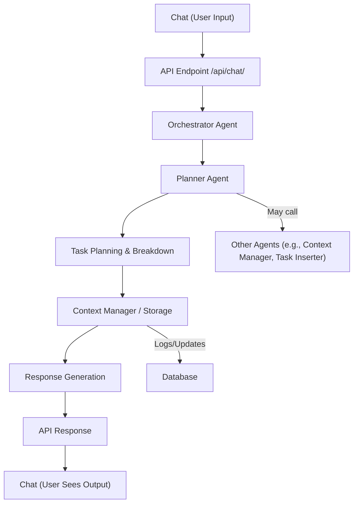

# Planner Agent Flow Diagram

**Description:**
- The flow starts with a user message in Chat.
- The message is sent to the API endpoint, which invokes the Orchestrator Agent.
- The Orchestrator delegates planning to the Planner Agent.
- The Planner Agent breaks down tasks, interacts with context/storage, and may call other agents.
- Results are logged/updated in the database, and a response is generated and returned to the user.
